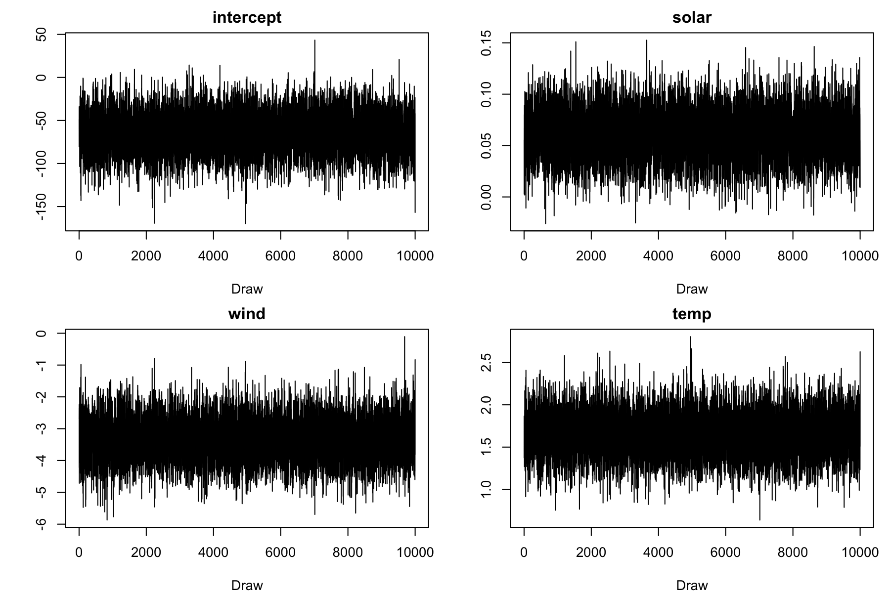

# BayesianRLS

Code to reproduce the results contained in the paper:

Agnoletto, D, Rigon, T, and Dunson, D. B. (2026+) **Martingale posteriors for flexible regression via
recursive least squares**, arXiv.

## Tutorial: Bayesian linear regression with heavy-tailed errors

The method takes three function calls. They only need the packages `Rcpp` and
`RcppArmadillo`. We use the `airquality` data of base R: daily ozone in New York, whose
regression residuals are skewed and heavy-tailed.

```r
Rcpp::sourceCpp("RLS_functions.cpp")
source("RLS_functions.R")

aq <- na.omit(airquality)
y <- aq$Ozone
X <- cbind(intercept = 1, solar = aq$Solar.R, wind = aq$Wind, temp = aq$Temp)
```

**Step 1. Posterior mean.** Recursive least squares gives the posterior mean `fit$beta`, here
essentially the least squares estimate, and the matrix `fit$V` (`V_n` in the paper). By default
the recursion starts from `beta_0 = 0` and the vague `V_0 = 1000 I`.

```r
fit <- rls_fit(y, X)
```

**Step 2. Predictive distribution.** We use a Student-t predictive distribution, with degrees of
freedom `nu` and scale `phi` selected by maximizing the leave-one-out prequential
log-likelihood (LOO-PLL).

```r
pred <- rls_predictive(fit, family = "student_t")
round(c(nu = pred$nu, phi = pred$phi), 2)
#>    nu   phi
#>  5.44 16.73
```

**Step 3. Posterior sampling.** Predictive resampling (Algorithm 2 of the paper) returns
independent draws from the martingale posterior, in a fraction of a second. By default it uses
`N = 10 n` and adds back the omitted part of the series through the Gaussian correction of
Algorithm 2.

```r
set.seed(1)
draws <- rls_posterior(fit, pred, B = 10000)

round(t(apply(draws, 2, function(b) c(mean = mean(b), sd = sd(b), quantile(b, c(0.025, 0.975))))), 3)
#>              mean     sd     2.5%   97.5%
#> intercept -64.360 23.201 -109.570 -19.024
#> solar       0.061  0.023    0.015   0.106
#> wind       -3.336  0.653   -4.605  -2.047
#> temp        1.651  0.255    1.152   2.149
```

**Using the posterior.** Any quantity is computed from the draws. For instance, for a hot,
calm and sunny day, the posterior of the mean ozone and of its 90% predictive quantile:

```r
x_new <- c(1, 250, 5, 90)              # intercept, solar, wind, temp
mean_new <- draws %*% x_new
q90_new <- mean_new + pred$phi * qt(0.90, pred$nu)
round(rbind(mean = quantile(mean_new, c(0.025, 0.5, 0.975)),
            q90 = quantile(q90_new, c(0.025, 0.5, 0.975))), 1)
#>      2.5%   50% 97.5%
#> mean 75.5  82.7  90.0
#> q90  99.9 107.1 114.4
```

**Independent draws.** Unlike Markov chain Monte Carlo, predictive resampling produces
independent draws: there is no burn-in, no thinning and no convergence diagnostic to check. The
trace plots show no trend or dependence, and the
autocorrelations of the draws, at lags 1 to 5, are all of the order of `1 / sqrt(B) = 0.01`,
their standard error for independent draws.

```r
par(mfrow = c(2, 2), mar = c(4, 4, 2, 1))
for (j in colnames(draws)) plot(draws[, j], type = "l", main = j, xlab = "Draw", ylab = "")
```



```r
round(sapply(colnames(draws), function(j) acf(draws[, j], lag.max = 5, plot = FALSE)$acf[-1]), 3)
#>      intercept  solar   wind   temp
#> [1,]     0.004 -0.002 -0.003  0.000
#> [2,]    -0.018  0.012 -0.010 -0.013
#> [3,]    -0.005 -0.021  0.000 -0.009
#> [4,]     0.005 -0.009 -0.006  0.007
#> [5,]     0.013 -0.005 -0.004  0.016
```

## Reproducing the paper

The shared functions are in `RLS_functions.R` and `RLS_functions.cpp`. Each folder corresponds to a
section of the paper or of the supplementary material. Its scripts are run from that folder, and
write their results (`.RData` files, figures and summary tables) to the subfolder `output/`.
The figures of the paper are written to `../../PAPER/figures` when that folder exists (as in the
authors' project), and to `output/` otherwise.
The `.RData` files contain, besides the metrics of the tables, the posterior summaries of each
dataset (means, standard deviations, HPD intervals and quantiles at each test point or for each
coefficient, with the true values), so that the summary scripts can be modified without
rerunning the simulations. Each simulation study uses 30 datasets per scenario.

| Folder | Section | Output | Scripts, in order |
|---|---|---|---|
| `sec5.1_uq_gaussian/` | 5.1 | Table 1 | `simulate.R`, `summarize_tables.R` |
| `sec5.2_illustration/` | 5.2 | Figure 1 (and, in `output/`, the fitted predictive distributions) | `student_t_errors.R`, `skew_t_errors.R`, `posteriors_figure.R` |
| `sec5.3_additive_models/` | 5.3, S2.3 | Table 2, Table S3 | `1_simulate_data.R`, `2_fit_rls_student_t.R`, `3_fit_rls_gaussian.R`, `4_fit_blm_brms.R`, `5_fit_bart.R`, `6_summarize_table.R` |
| `sec6_application/` | 6, S3, S4 | Figure 2, Figures S1 to S6, results of Section 6 | `1_download_data.R` (downloads the NHANES data into `appl_data.RData`, already included), `2_analysis.R` |
| `secS2.1_uq_student_t/` | S2.1 | Table S1 | `simulate.R`, then `../sec5.1_uq_gaussian/summarize_tables.R` with argument `t` |
| `secS2.2_frequentist_am/` | S2.2 | Table S2 | `1_fit_frequentist_am.R`, `2_summarize_table.R`; both use the output of `sec5.3_additive_models/` |

The sample size of the simulations is passed as the first argument, as a multiple of the number
of covariates: for instance, `Rscript 2_fit_rls_student_t.R 100` runs the scenario with n = 100p. Without
arguments, the first scenario of the paper is used. The summaries of Table 1 and Table S1 take a
second argument, `norm` or `t`, for instance `Rscript summarize_tables.R 10 t`.

`run_all.sh` runs everything in the right order, or only the given folders
(e.g. `./run_all.sh sec5.3_additive_models`). On macOS it keeps the machine awake, and its log
`run_all.log` reports for each step the elapsed time and the number of system sleep events: the
computing times are reliable only for steps with no sleep events.

In `sec6_application/2_analysis.R`, the traditional Bayesian model is also fitted with a vague
Gamma(0.001, 0.001) prior on the smoothing parameters, for the sensitivity analysis of Section 6;
the trace plot of a selected coefficient is saved in `output/` as a diagnostic.

R packages: `Rcpp`, `RcppArmadillo`, `mgcv`, `coda`, `brms` (with `rstan`), `BART`, `robustBLME`,
`extraDistr`, `parallel`, `ggplot2`, `ggthemes`, `ggpubr`, `ggcorrplot`, `latex2exp`, `scales`,
`haven`, `dplyr`, `sn`.
